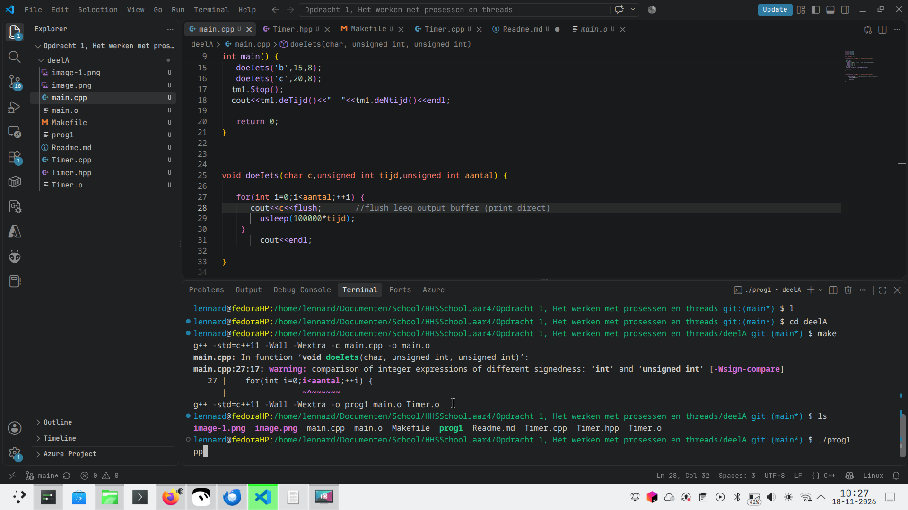
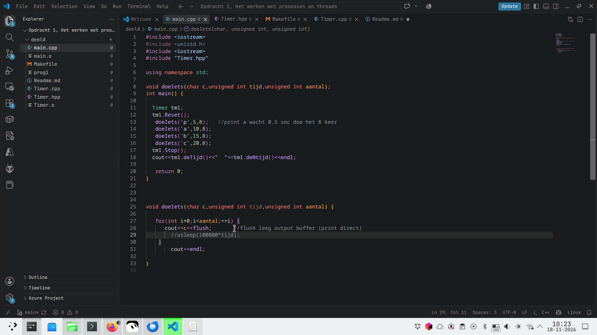
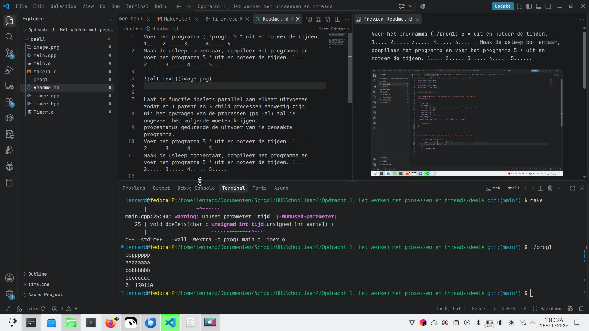

1. Voer het programma (./prog1) 5 * uit en noteer de tijden. 1.... 2..... 3..... 4..... 5......



antwoord:
Hij wacht tussen iedere print in in een seriele manier dus achter elkaar hier draait niks parralel

2. Maak de usleep commentaar, compileer het programma en voer het programma 5 * uit en noteer de tijden. 1.... 2..... 3..... 4..... 5......




Antwoord:
Hij print nu gelijk het antwoord zonder te wachten.


3. Laat de functie doeIets parallel aan elkaar uitvoeren zodat er 1 parent en 3 child processen aanwezig zijn.
Bij het opvragen van de processen (ps -al) zal je ongeveer het volgende moeten krijgen:
procestatus gedurende de uitvoer van je gemaakte programma.
Voer het programma 5 * uit en noteer de tijden. 1.... 2..... 3..... 4..... 5......

```sh
lennard@fedoraHP:/home/lennard $ ps -al
F S   UID     PID    PPID  C PRI  NI ADDR SZ WCHAN  TTY          TIME CMD
0 S  1000 1003598  930779  0  80   0 -  1681 hrtime pts/1    00:00:00 prog1
1 S  1000 1003599 1003598  0  80   0 -  1681 hrtime pts/1    00:00:00 prog1
1 S  1000 1003600 1003598  0  80   0 -  1681 hrtime pts/1    00:00:00 prog1
1 S  1000 1003602 1003598  0  80   0 -  1681 hrtime pts/1    00:00:00 prog1
4 R  1000 1003630  938298 99  80   0 - 58829 -      pts/2    00:00:00 ps
```

```sh
lennard@fedoraHP:/home/lennard/Documenten/School/HHSSchoolJaar4/Opdracht 1, Het werken met prosessen en threads/deelA git:(main*) $ ./prog1
PID0: 1003598
PID1 (child a): 1003599
aPID2 (child b): 1003600
bPID1: 1003599
PID2: 1003600
PID3: 1003602
PID3 (child c): 1003602
pcpapbpacppabppac
baacbab
cbcbc
c
16002  16002910642
```

4. Maak de usleep commentaar, compileer het programma en voer het programma 5 * uit en noteer de tijden. 1.... 2..... 3..... 4..... 5......

PID1 (child a): 1006339
aaaaaaaa
PID2 (child b): 1006340
bPID1: 1006339
bPID2: 1006340
bPID3: 1006341
bbbbbp
ppppppp
PID3 (child c): 1006341
cccccccc
1  1053947

Wat valt je op? 

dat de tekst door elkaar heen wordt geprint dit is omdat er geen locking is op de stdout waardoor alle tekst door elkaar wordt geprint.